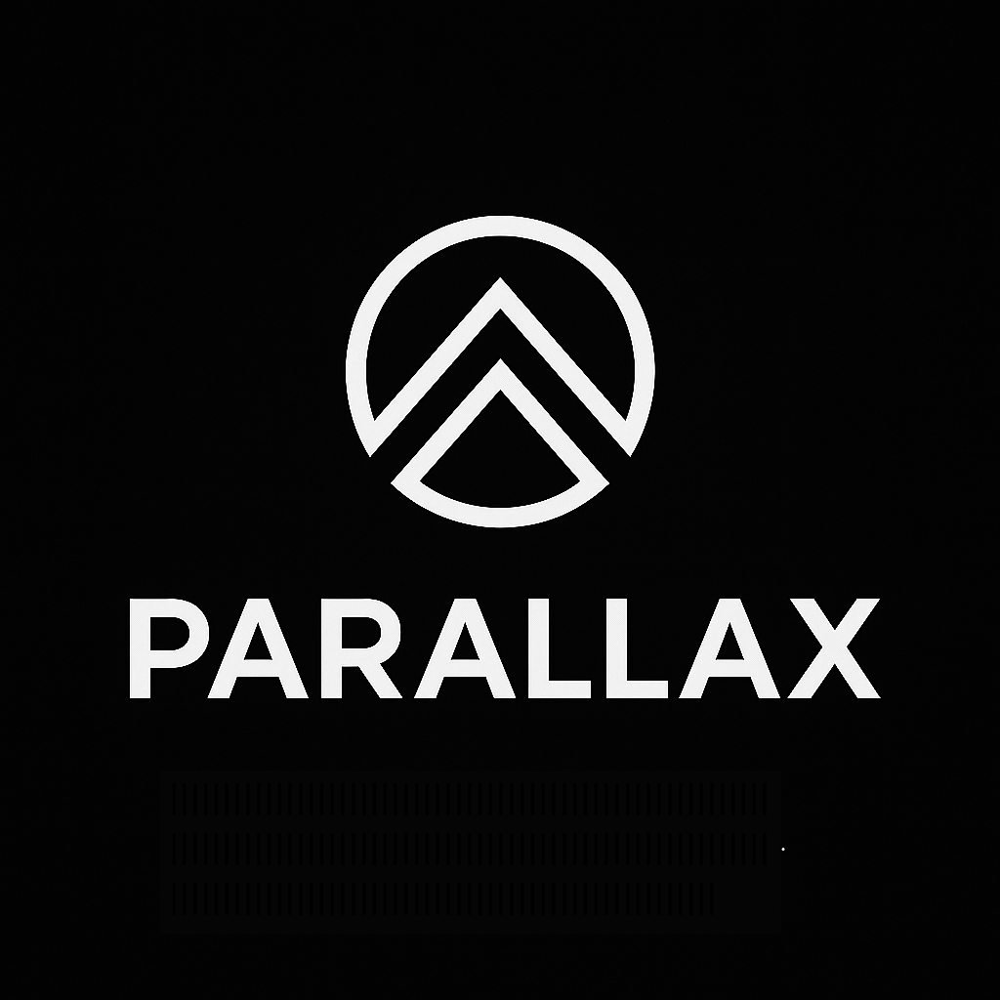

<!DOCTYPE html>
<html lang="en">
<head>
    <meta charset="UTF-8">
    <meta name="viewport" content="width=device-width, initial-scale=1.0">
    <title>Parallax (PLX) Whitepaper | Layer 1 Blockchain</title>
    
    <meta name="description" content="Read the official Parallax (PLX) whitepaper. Explore our independent Layer 1 Scrypt Proof-of-Work blockchain architecture, consensus, and security model.">
    <meta name="robots" content="index, follow">
    <link rel="canonical" href="https://paraplx.com">
    <link rel="icon" type="image/png" href="logo.png">

    
</head>
<body>

    <header>
        

            
        

        
Parallax PLX

    </header>

    <nav>
        <a href="index.html">Home</a>
        <a href="support.html">Support</a>
        <a href="whitepaper.html" class="active">Whitepaper</a>
        <a href="sponsorship.html">Sponsorship</a>
        <a href="faq.html">FAQ</a>
    </nav>

    <main>
        <h1>Parallax (PLX) Whitepaper</h1>
        
Independent Layer 1 Scrypt Proof-of-Work Cryptocurrency

        

            

                
ProjectParallax

                
TickerPLX

                
BlockchainParallax Mainnet

                
Asset TypeNative Layer 1

                
ConsensusProof of Work

                
AlgorithmScrypt

                
Block Reward50 PLX

                
Official ClientParallax Core

                

                    <a href="https://paraplx.com">Official Website</a>
                    <a href="https://explorer.paraplx.com">Block Explorer</a>
                    <a href="https://github.com/ParallaxCoreDevelopers/parallax_wallet_miner">Source Code</a>
                

            

        

        <section>
            <h2>1. Introduction</h2>
            
Parallax (PLX) is an independent open-source Layer 1 cryptocurrency operating on its own blockchain.

            
PLX is the native currency of the Parallax network. It is not an ERC-20, BEP-20 or other token issued on top of another blockchain and therefore does not require a token contract address for native transfers.

            
The Parallax blockchain begins from its own Genesis Block 0 and maintains its own independent block history, transaction history, peer-to-peer network and consensus rules.

            
Parallax uses Scrypt Proof-of-Work consensus. Miners contribute computational hashing power to create blocks, confirm transactions, extend the blockchain and participate in securing the network.

            
The current block subsidy is 50 PLX per block.

            
The official desktop application, Parallax Core, combines a full blockchain node, native PLX wallet, integrated Scrypt mining controls, wallet encryption, backup tools, message signing and verification, peer information, network traffic information, blockchain information and RPC tools in one Windows application.

            
Parallax Core should therefore not be viewed merely as a Layer 1 wallet. Parallax is the Layer 1 blockchain. Parallax Core is the official full-node software used to participate directly in that Layer 1 network.

        </section>

        <section>
            <h2>2. Project Objectives</h2>
            
Parallax was created around several core objectives:

            <ul>
                <li>Operate an independent public blockchain.</li>
                <li>Maintain its own native PLX cryptocurrency.</li>
                <li>Use Scrypt Proof-of-Work consensus.</li>
                <li>Allow users to independently operate full blockchain nodes.</li>
                <li>Provide a native wallet without requiring custodial services.</li>
                <li>Integrate optional mining directly into the official desktop application.</li>
                <li>Provide wallet encryption and security tools.</li>
                <li>Provide peer, network traffic and node information.</li>
